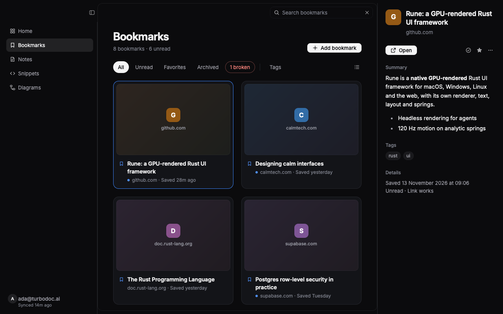
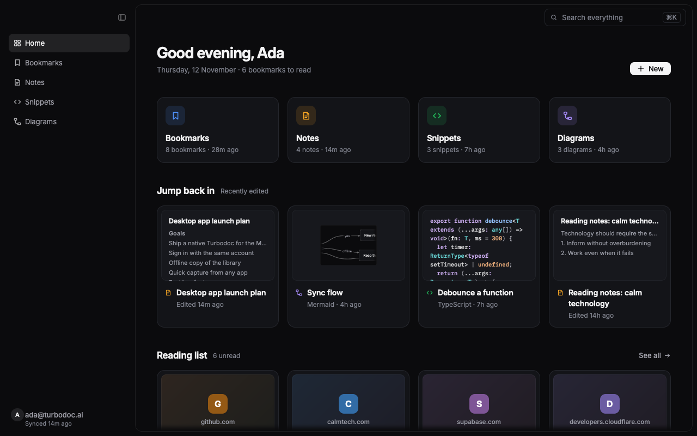
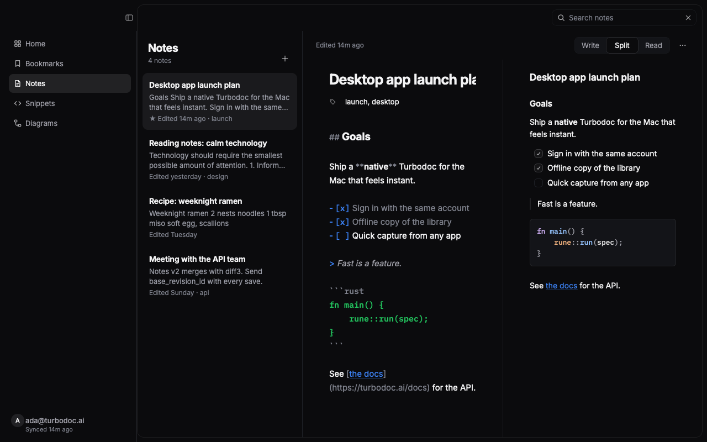
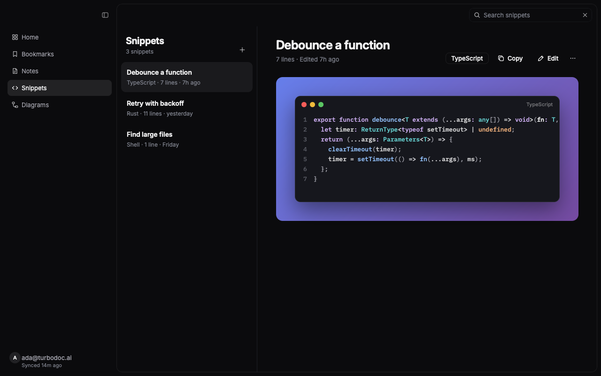
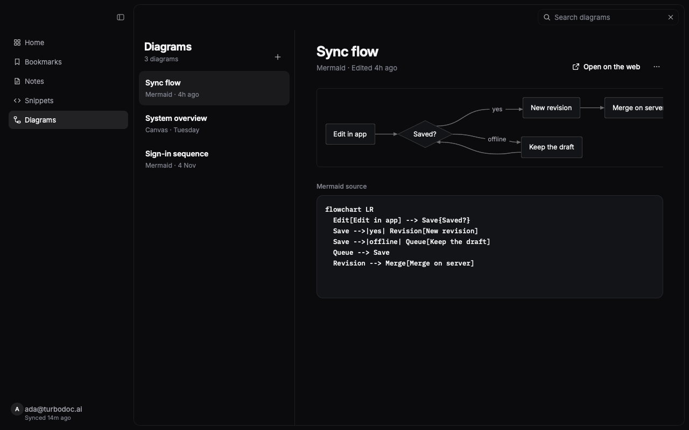
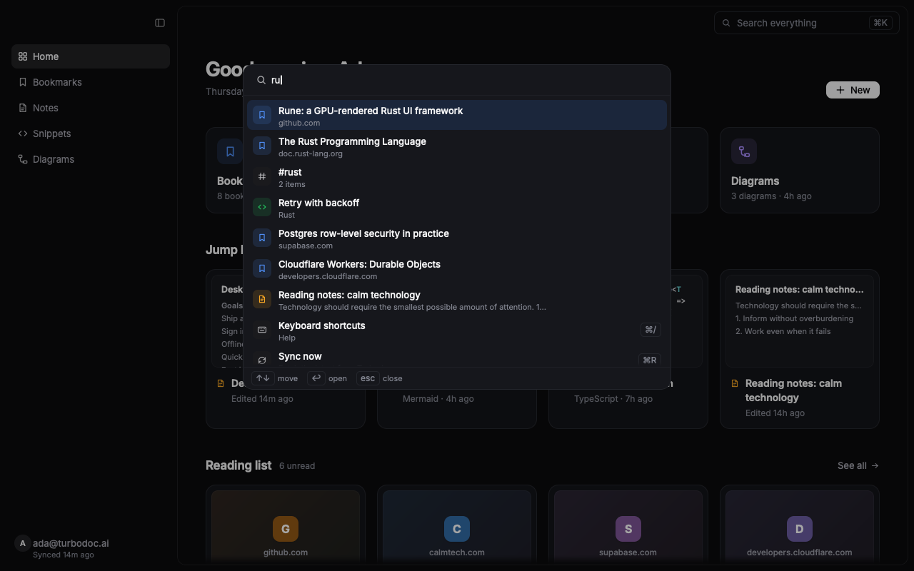
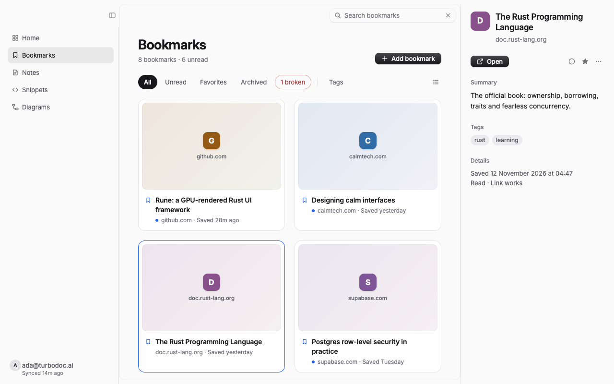

# Turbodoc for desktop

The Turbodoc desktop app: bookmarks, notes, code snippets and diagrams, in a native window
drawn on the GPU by [Rune](https://github.com/anomalyco/rune). It talks to the same API as
the web, iOS and browser-extension clients (`api.turbodoc.ai`) and signs in to the same
Supabase account.



| | |
| --- | --- |
|  |  |
|  |  |
|  |  |

## What being native adds

- **Quick capture from any app.** Press **⌃⌥Space** anywhere. A panel drops over the app
  you're in without taking focus from it, and offers a link on the clipboard right away.
  Press Return to save it as a bookmark; text becomes a note.
- **It opens with everything on screen.** The library is kept per account in the app's data
  folder. The window draws it before the network answers, and the app keeps working offline:
  the toolbar says when you are.
- **The session stays in the keychain** (Keychain, Credential Manager or the Secret Service),
  never in a plain file. Tokens refresh before they expire, and once more after a 401.
- **Native menus and shortcuts.** File, Edit, View and Help menus with key equivalents, Dock
  menu items, and a native context menu on every item. ⌘K searches everything and runs any
  command. ⌘1–⌘5 move between sections and ⌘R syncs.
- **Drag and drop.** Drop `.md` or `.txt` files on the window to make notes, and source files
  to make snippets. Drag a bookmark card into another app to hand over its link.
- **Paste anywhere.** With nothing focused, ⌘V of a link opens "Add bookmark" filled in.
  Pasted text becomes a note.
- **Notes merge, never clobber.** Notes use the API's v2 revision model, as the web and iOS
  apps do. Every autosave sends its base revision, and the server three-way merges edits
  made on other devices. Version History lists revisions and restores one as a new revision.
- **Native rendering throughout.** Mermaid diagrams are drawn by `rune-mermaid` with no web
  view or JavaScript. Code is coloured by Rune's lexers. Markdown is styled as you type and
  previewed live.
- **Deep links.** `turbodoc://note/<id>`, `turbodoc://bookmark/<id>`, `turbodoc://snippet/<id>`,
  `turbodoc://diagram/<id>` and `turbodoc://save?url=…` all work. A second launch hands its
  link to the running app.
- **Undoable deletes.** A deleted item leaves the screen at once and waits six seconds before
  it goes to the server. Undo it from the toast or with ⌘Z. Pending deletes are sent before
  the app quits.
- **System notifications.** A quick capture saved while Turbodoc is in the background posts
  one.

## Run it

You need Rust 1.99 or later; edition 2024.

```bash
cargo run --release
```

To try a build as an app on this Mac, signed ad hoc and copied to `~/Applications`:

```bash
scripts/bundle-macos.sh --install
```

An ad-hoc signature changes with every build. macOS ties keychain access to the signature, so
after a rebuild it asks once whether Turbodoc may read its saved session. The window doesn't
wait for that answer: it opens on the offline copy of your library, and syncing starts once
you allow access. Signing with a real identity stops the question coming back.

## Release it

[cargo-packager](https://github.com/crabnebula-dev/cargo-packager) makes the installers from
`Packager.toml`, and `scripts/package.sh` builds and packages for the OS it runs on, into `dist/`:

| OS | Installers | Signing |
| --- | --- | --- |
| macOS | `Turbodoc_<version>_universal.dmg`: Apple silicon and Intel | Developer ID and notarization, or ad hoc |
| Windows | `Turbodoc_<version>_x64-setup.exe` (per user, no admin) and `…_x64_en-US.msi` | Azure Artifact Signing, or none |
| Linux | `turbodoc_<version>_amd64.deb` and `Turbodoc_<version>_x86_64.AppImage` | none needed |

Each one registers `turbodoc://` links, except the AppImage, which has nowhere to install a
desktop entry.

```bash
cargo install cargo-packager --locked
scripts/package.sh --native   # macOS: this Mac's architecture; drop --native for universal (needs rustup)
```

### Through GitHub

`.github/workflows/release.yml` runs on macOS, Windows and Linux for every push and pull
request: it runs the tests, packages, and keeps the installers on the run for a week. To
release, raise `version` in `Cargo.toml`, then tag and push:

```bash
git tag v0.2.0 && git push origin v0.2.0
```

The tag's run drafts a GitHub release with every installer and a `SHA256SUMS.txt`. Check it,
then publish it.

Signing turns on per platform once the repository has its secrets (Settings → Secrets and
variables → Actions):

| Platform | Secrets | Where they come from |
| --- | --- | --- |
| macOS signing | `APPLE_CERTIFICATE` (the `.p12`, base64), `APPLE_CERTIFICATE_PASSWORD`, `APPLE_SIGNING_IDENTITY` | A "Developer ID Application" certificate from the Apple Developer Program, exported from Keychain Access. `base64 -i cert.p12 \| pbcopy` |
| macOS notarization | `APPLE_API_ISSUER`, `APPLE_API_KEY` (the key ID), `APPLE_API_KEY_P8` (the `.p8` file's text) | App Store Connect → Users and Access → Integrations → Team Keys, with the Developer role |
| Windows | `AZURE_TENANT_ID`, `AZURE_CLIENT_ID`, `AZURE_CLIENT_SECRET`, plus the variables `ARTIFACT_SIGNING_ENDPOINT`, `ARTIFACT_SIGNING_ACCOUNT` and `ARTIFACT_SIGNING_PROFILE` | An Azure Artifact Signing account and certificate profile, and an app registration with the "Artifact Signing Certificate Profile Signer" role |

Without them every build still succeeds: macOS is signed ad hoc (Gatekeeper then blocks a
downloaded copy until it is allowed in System Settings → Privacy & Security) and Windows is
unsigned (SmartScreen warns before it runs).

The icons in `assets/icons/` come from `assets/icon-1024.png`. After changing it, run
`scripts/make-icons.sh` on a Mac.

### On Windows and Linux

- Shortcuts use Ctrl where macOS uses ⌘, and the app writes them that way: "Ctrl+K", and
  Ctrl+Alt+Space for quick capture.
- The session is kept in Credential Manager on Windows and in the Secret Service on Linux
  (GNOME Keyring or KWallet). Without a running Secret Service, Linux can't keep you signed in
  between launches.
- Quick capture opens as an ordinary small window, not a floating panel. On Wayland the
  desktop may ask before letting Turbodoc have the global shortcut, or offer another.
- A Linux build needs `libxkbcommon-dev` and `libwayland-dev` (Debian and Ubuntu names).

### Settings for development

| Variable | Effect |
| --- | --- |
| `TURBODOC_API_URL` | Uses another API, such as `https://api-dev.turbodoc.ai` or `http://localhost:8787`. |
| `TURBODOC_INSECURE_SESSION=1` | Keeps the session in the data folder, not the keychain. An unsigned build that is rebuilt often otherwise makes the keychain ask again after each rebuild. |
| `RUNE_DIRS_ROOT=/tmp/td` | Puts every folder the app writes under one root. |

## Check it without an account

Every Rune app also runs headless. Demo scenes put a made-up library on each screen, so you
can render any screen, or drive it with scripts, without signing in or using the network:

```bash
cargo build
target/debug/turbodoc --list-scenes
target/debug/turbodoc --snap out.png --scene bookmarks --size 1280x800 --window main
target/debug/turbodoc --snap capture.png --window capture --size 560x150
```

`cargo test` runs the unit tests and the interaction tests in `src/tests.rs`. The interaction
tests drive the real views through Rune's runtime: they click, type, paste and press keys.

## Layout

| Path | What's there |
| --- | --- |
| `src/api/` | Supabase Auth (`auth.rs`), one function per REST call (`client.rs`), and the models, field for field (`models.rs`). |
| `src/net/` | A blocking HTTP layer over ureq, and two fixed worker pools: one for requests and one for media. |
| `src/store/` | Keychain secrets, the offline library snapshot, and the bounded preview-image cache. |
| `src/app/` | The app's state and its explicit state machines: sign-in phase, sync, autosave and deferred deletes. Actions are applied optimistically and roll back on error. |
| `src/ui/` | Every screen: shell, home, bookmarks, notes, snippets, diagrams, palette, dialogs, settings and sign-in. Also the theme and icons. |
| `src/capture.rs` | The quick-capture panel (a second window), with its global shortcut. |
| `src/demo.rs` | The demo library and the headless scenes. |
| `Packager.toml`, `scripts/` | How the installers are made: `package.sh` (all three platforms), `bundle-macos.sh` (a quick local `.app`) and `make-icons.sh`. |
| `.github/workflows/` | The release workflow: tests, installers and signing on macOS, Windows and Linux. |

Views never block. Every network call runs on a worker, and its answer comes back to the UI
thread through `AppHandle::update`. The first fetch starts in `on_ready`, after the first
frame. An idle window draws nothing.
